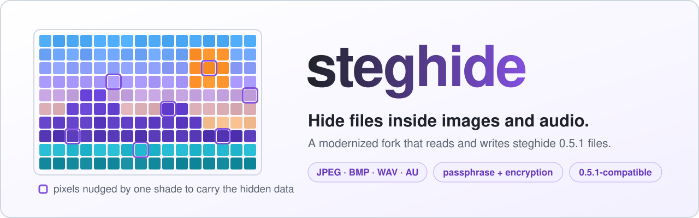
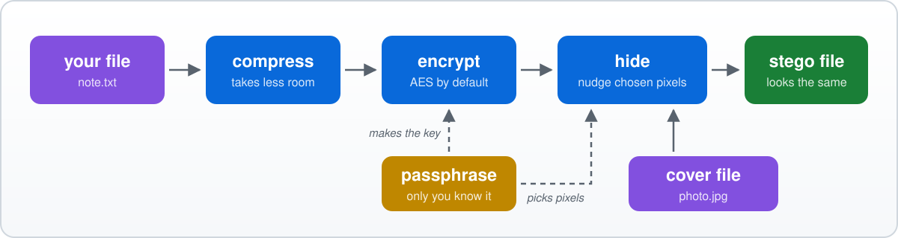

<div align="center">

<picture>
  <source media="(prefers-color-scheme: dark)" srcset="docs/images/banner-dark.svg">
  
</picture>

<br>

[](https://github.com/cgbeaulieu/steghide/actions/workflows/ci.yml)


<br>


**[Quick start](#-quick-start)** · **[How it works](#-how-it-works)** · **[What's new](#-whats-new-in-this-fork)** · **[Build](#-build-from-source)** · **[Roadmap](ROADMAP.md)**

</div>

> [!NOTE]
> This is a community fork of [StegHigh/steghide](https://github.com/StegHigh/steghide), which carries the steghide 0.5.1 code from 2003. It is not an official steghide release. It reads and writes the same files as steghide 0.5.1, with the same commands.

## 🕵️ What is steghide?

Steghide hides a file inside an ordinary-looking picture or sound file. It changes the cover so slightly that nobody can see or hear the difference, and only someone with the passphrase can get the hidden file back out.

<table>
<tr>
<td width="50%" valign="top">

### 🖼️ Four cover formats
JPEG and BMP images, WAV and AU audio.

</td>
<td width="50%" valign="top">

### 🔐 Encrypted
Your file is encrypted with your passphrase first: AES with a 256-bit key by default.

</td>
</tr>
<tr>
<td width="50%" valign="top">

### 🗜️ Compressed and checked
Compressed to take less room, with a checksum that catches damage.

</td>
<td width="50%" valign="top">

### 🎨 Hard to spot
It mostly swaps values between pixels or samples, so the overall colour and sound statistics stay the same.

</td>
</tr>
</table>

## 🚀 Quick start

Hide `note.txt` in `photo.jpg`:

```console
$ steghide embed -cf photo.jpg -ef note.txt
Enter passphrase:
Re-Enter passphrase:
embedding "note.txt" in "photo.jpg"... done
```

See what a file holds, and how much it can hold:

```console
$ steghide info photo.jpg
"photo.jpg":
  format: jpeg
  capacity: 147.0 Byte
Try to get information about embedded data ? (y/n) y
Enter passphrase:
  embedded file "note.txt":
    size: 13.0 Byte
    encrypted: rijndael-128, cbc
    compressed: yes
```

Get it back:

```console
$ steghide extract -sf photo.jpg
Enter passphrase:
wrote extracted data to "note.txt".
```

> [!TIP]
> Use `-sf other.jpg` with `embed` to write the result to a new file instead of changing `photo.jpg`, `-p` to give the passphrase on the command line, and `steghide --help` for every option.

## 🧩 How it works

<picture>
  <source media="(prefers-color-scheme: dark)" srcset="docs/images/how-it-works-dark.svg">
  
</picture>

The passphrase does two jobs: it encrypts your file, and it decides which pixels or samples carry the data. Steghide pairs up values that can simply trade places, so most changes are swaps that leave the colour (or sound) statistics untouched. Extraction runs the same steps backwards.

| Format | What steghide changes | Variants |
| --- | --- | --- |
| **JPEG** | the compressed image data (non-zero DCT coefficients) | baseline and progressive |
| **BMP** | colours (24-bit) or palette entries (1-, 4- and 8-bit) | Windows and OS/2 bitmaps |
| **WAV** | audio samples | 8- and 16-bit PCM |
| **AU** | audio samples | 8-bit µ-law, 8- and 16-bit PCM |

## ✨ What's new in this fork

Using steghide hasn't changed. What changed is everything underneath it.

| | steghide 0.5.1 (2003) | this fork |
| --- | :---: | :---: |
| Reads and writes 0.5.1 files | ✅ | ✅ checked both ways against a real 0.5.1 |
| Needs libmcrypt and libmhash, unmaintained since 2007 | ⚠️ yes | ✅ no, the ciphers are built in |
| Long-file-name stack overflow (CVE-2026-31024) | ❌ | ✅ fixed |
| Large payload in a big 24-bit BMP | 💥 crashes | ✅ works |
| A stego file can make `extract` write outside the current folder | ❌ yes | ✅ fixed |
| Embedding in 8-bit WAV can turn loud samples into clicks | ❌ yes | ✅ fixed |
| Damaged or crafted files crash it or make it use gigabytes of memory | ❌ yes | ✅ fixed, found by fuzzing |
| Memory errors found by ASan and UBSan | ❌ several | ✅ none |
| Memory leaks | ❌ yes | ✅ none |
| Builds on today's compilers | ⚠️ needs distro patches | ✅ GCC and Clang, no warnings |
| Build system | autotools | CMake |
| Tests | unit and system tests | ➕ 0.5.1 compatibility, cipher test vectors, sanitizer and leak checks, fuzzing, all on every push |

<details>
<summary><b>How it is tested</b></summary>

<br>

- **`tests/compat`** holds 50 files embedded by an unmodified steghide 0.5.1: every cover format, every cipher, every cipher mode, every option, and empty, non-ASCII and long passphrases. `check.sh` extracts them with the new build, and also embeds every case with the new build and extracts it with 0.5.1.
- **`tests/vectors`** holds about 800 answers recorded from the real libmcrypt 2.5.8 and libmhash, for every algorithm, mode and key length. The built-in replacements must give the same answer to each one.
- **Sanitizers.** Every test runs under AddressSanitizer, UndefinedBehaviorSanitizer and LeakSanitizer with GCC and Clang.
- **Fuzzing.** The cover file parsers and the embedded data format are fuzzed with libFuzzer, and the tests replay an input for each bug it found ([`fuzz/`](fuzz/README.md)).
- **CI.** Every push and pull request is built and tested on Ubuntu with GCC and Clang, with and without the sanitizers, against Ubuntu's own steghide 0.5.1. It fails on any compiler warning outside the libmcrypt code, and fuzzes each target for two minutes ([`ci.yml`](.github/workflows/ci.yml)).

</details>

<details>
<summary><b>Encryption algorithms</b></summary>

<br>

The same 18 as steghide 0.5.1 with libmcrypt 2.5.8, so every 0.5.1 file can still be read. The default is `rijndael-128` (AES) in CBC mode. Choose another with `-e`, for example `-e twofish cbc`, or list them all with `steghide encinfo`.

`arcfour` · `blowfish` · `cast-128` · `cast-256` · `des` · `enigma` · `gost` · `loki97` · `rc2` · `rijndael-128` · `rijndael-192` · `rijndael-256` · `saferplus` · `serpent` · `tripledes` · `twofish` · `wake` · `xtea`

These exist to stay compatible. For anything new, stick with the default.

</details>

> [!WARNING]
> Steghide's file format is from 2003, and so is the way it turns a passphrase into keys ([CVE-2021-27211](https://nvd.nist.gov/vuln/detail/CVE-2021-27211)). Tools such as [stegseek](https://github.com/RickdeJager/stegseek) can try millions of passphrases per second, and can tell that a file holds steghide data without knowing the passphrase. Use a long, random passphrase, and don't count on steghide alone against a determined attacker. A new, stronger format is on the [roadmap](ROADMAP.md).

## 🔨 Build from source

You need a C++20 compiler (GCC or Clang), CMake 3.20 or later, libjpeg and zlib.

| Distribution | Install the dependencies |
| --- | --- |
| Arch, CachyOS | `sudo pacman -S cmake libjpeg-turbo zlib` |
| Debian, Ubuntu | `sudo apt install cmake g++ libjpeg-dev zlib1g-dev` |
| Fedora | `sudo dnf install cmake gcc-c++ libjpeg-turbo-devel zlib-devel` |

```bash
git clone https://github.com/cgbeaulieu/steghide.git
cd steghide
cmake -B build
cmake --build build
ctest --test-dir build
sudo cmake --install build
```

| CMake option | What it does |
| --- | --- |
| `STEGHIDE_SANITIZE` | build with sanitizers, for example `-DSTEGHIDE_SANITIZE=address,undefined`; the tests then also check for leaks |
| `STEGHIDE_COMPAT_REFERENCE` | path to a steghide 0.5.1, for example `/usr/bin/steghide`; the tests then also check that it can read what the new build writes |
| `STEGHIDE_NLS` | `OFF` leaves out the translations (German, Spanish, French, Romanian, Russian) |
| `STEGHIDE_DEBUG` | `ON` includes steghide's debugging commands |
| `STEGHIDE_FUZZ` | `ON` builds the fuzz targets with libFuzzer (Clang only), see [`fuzz/README.md`](fuzz/README.md) |

After changing messages, `cmake --build build --target update-po` updates `po/steghide.pot` and the translations. With Doxygen installed, `--target doxygen` writes the source documentation to `build/doxygen`.

## 🗺️ Roadmap

| Phase | Status | What it covers |
| --- | --- | --- |
| **1. Baseline** | ✅ done | Debian and Fedora patches, compatibility test files from a real 0.5.1 |
| **2. Modernize without changing the format** | ✅ done | CMake, built-in ciphers, memory fixes, no leaks or warnings, fuzzing, a secure random source, CI |
| **3. A new, stronger format** | 📝 planned | modern key derivation and authenticated encryption, while still reading old files |
| **4. Later** | 💭 ideas | PNG support, a library other programs can use |

The details, and the bugs found so far, are in [ROADMAP.md](ROADMAP.md).

## 🙏 Credits

- **Stefan Hetzl** wrote steghide (1999–2003).
- **[StegHigh](https://github.com/StegHigh/steghide)** (Stefano De Vuono and contributors) kept it building after 2003.
- **Debian and Fedora maintainers** wrote the patches this fork started from; each keeps its author in the git history.
- **libmcrypt** (Nikos Mavroyanopoulos and the authors of each cipher) and **libmhash**, whose code and behaviour live on in [`src/mcrypt`](src/mcrypt/README.md).
- **[alexnorell/steghide](https://github.com/alexnorell/steghide)**, whose list of libmcrypt quirks was a useful checklist.

## 📜 License

GPL-2.0-or-later, see [COPYING](COPYING). The ciphers in `src/mcrypt` are public domain or LGPL-2.1-or-later, see [`src/mcrypt/README.md`](src/mcrypt/README.md). steghide's original documentation is in [README](README).
